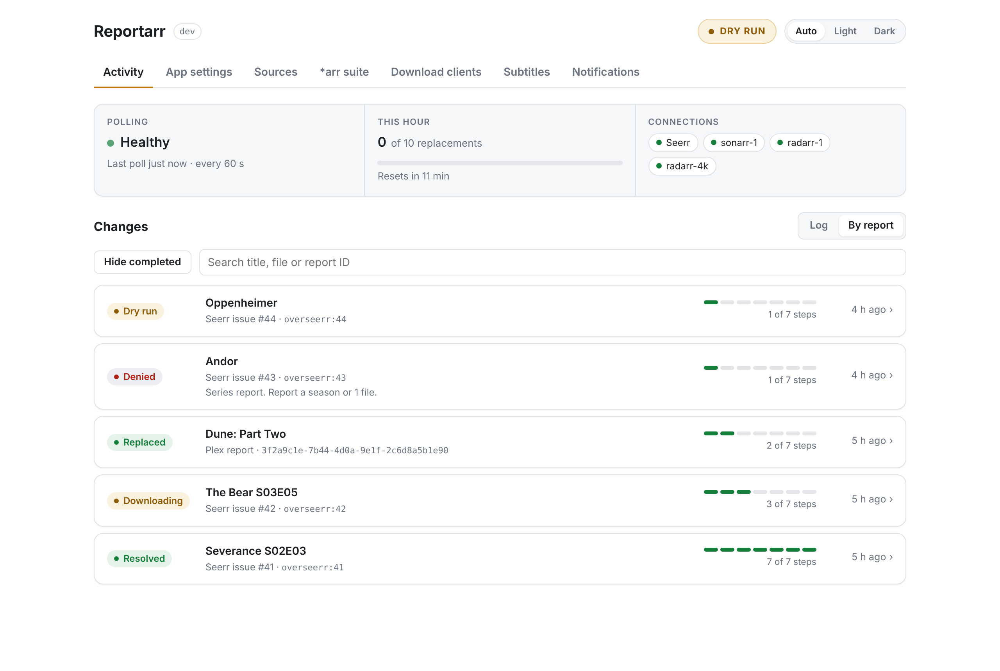
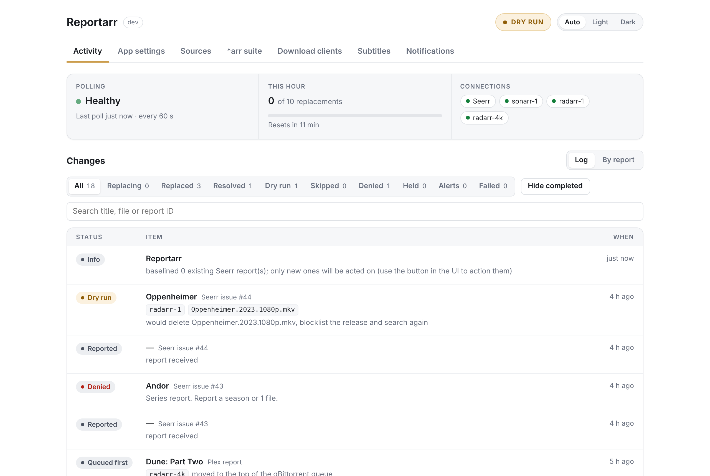
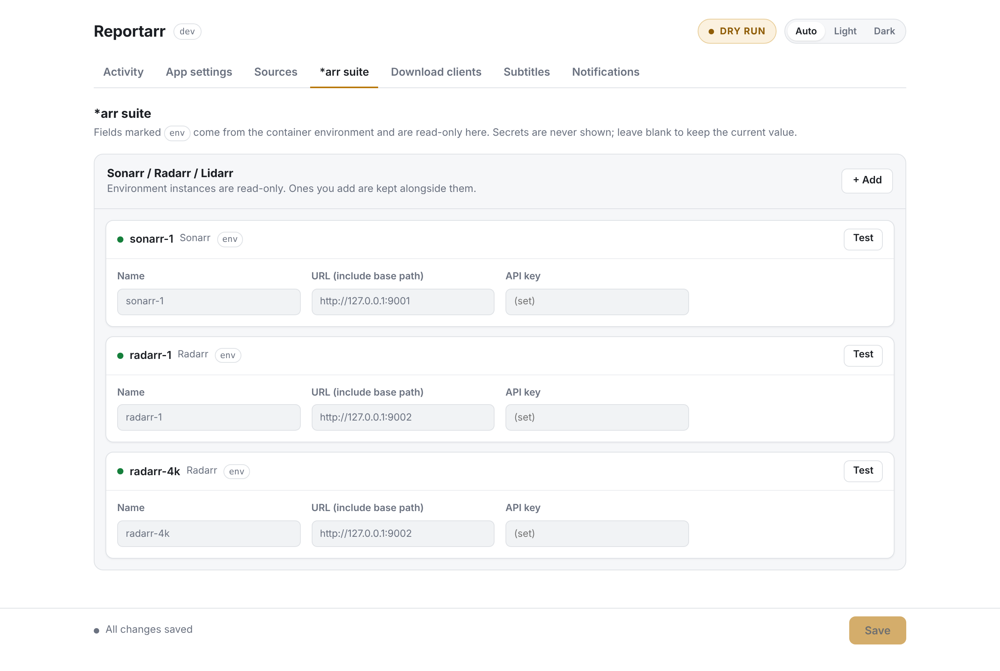
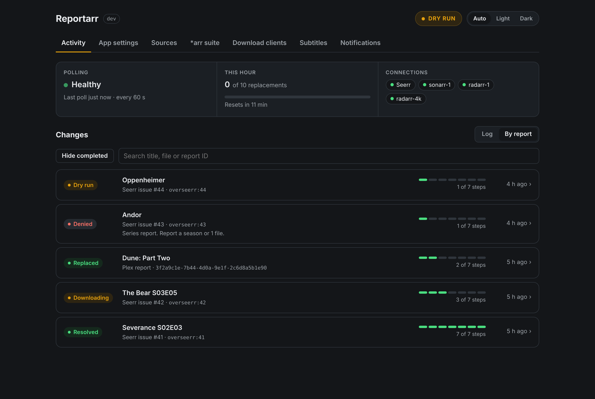

### This is AI slop

# Reportarr

Automagically fix Plex reports.

When a user uses Plex's **Report an issue** (on any of your Plex servers, or an Overseerr/Seerr issue on any of your instances) on a title (bad quality, wrong movie, broken file), Reportarr finds the reported file in Sonarr, Radarr or Lidarr, deletes it, blocklists the release it came from, and searches again. Nobody has to hand-manage anything.

> **Built by Claude.** This app was written by [Claude](https://claude.com/claude-code) (Anthropic's AI coding assistant) working with the repository owner, and has been tested against a real Plex, Sonarr, Radarr, qBittorrent and SABnzbd setup. Treat it like any young project: start in dry-run mode, read the code, and keep backups of anything you can't re-download.



## What it does

1. Polls Plex's **Reported Issues** on every Plex server you add, and optionally the open issues on your Overseerr/Seerr instances (every 60 seconds by default; neither has a webhook for this).
2. Finds the reported file and the Sonarr, Radarr, Lidarr or Whisparr instance that owns it (several instances, such as 1080p and 4K, are fine).
3. Deletes the file, blocklists the release it came from, and searches again.
4. Optionally moves the replacement to the top of the qBittorrent or SABnzbd queue, fixes subtitle reports through Bazarr, and tells you (and the reporter) on Discord or by email.
5. Follows each report until the new file is in Plex, then resolves the Seerr issue.

The report text is ignored on purpose: any report on a file means "replace this file".

## Safety

- **Dry run is on by default.** Nothing is deleted until you set `DRY_RUN=false`.
- **Reports that existed before Reportarr started are never acted on** automatically (a button in the UI can action them).
- An **hourly limit** (`MAX_PER_HOUR`, default 10) and a **per-user daily limit** (`MAX_PER_USER_PER_DAY`, default 5) cap how much bad reports can delete.
- **Set `UI_PASSWORD`.** Without it, anyone who can reach the page can change settings and trigger deletions.

More in [Safety and limits](docs/Safety-and-limits.md) and [Security and limitations](docs/Security-and-limitations.md).

## Install

```yaml
services:
  app:
    image: ghcr.io/trentnbauer/reportarr:latest
    restart: unless-stopped
    ports:
      - ${WEB_UI:-8080}:8080
    volumes:
      - data:/data
    env_file:
      - path: .env
        required: false
volumes:
  data:
```

Copy [`.env.example`](.env.example) to `.env` next to [`docker-compose.yml`](docker-compose.yml) and fill it in, or skip it and set everything up in the web UI (its **Download .env** button exports your settings later). Open `http://<host>:8080`, watch the activity in dry run for a while, then set `DRY_RUN=false`.

## Screenshots

| Log view | Settings | Dark mode |
|---|---|---|
|  |  |  |

## Documentation

- [Configuration](docs/Configuration.md): every environment variable
- [Web UI](docs/Web-UI.md), [Notifications](docs/Notifications.md), [Subtitles (Bazarr)](docs/Subtitles.md), [Reverse proxy](docs/Reverse-proxy.md)
- [How a report is matched to a file](docs/How-matching-works.md)
- [Development](docs/Development.md): project layout, adding an integration, tests

## Licence

None chosen yet. Until the owner adds one, all rights are reserved.
